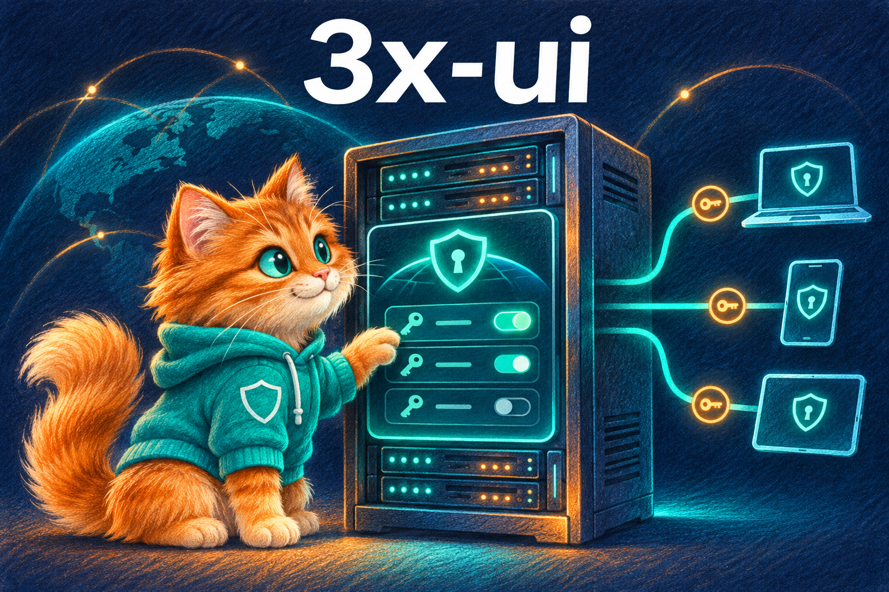
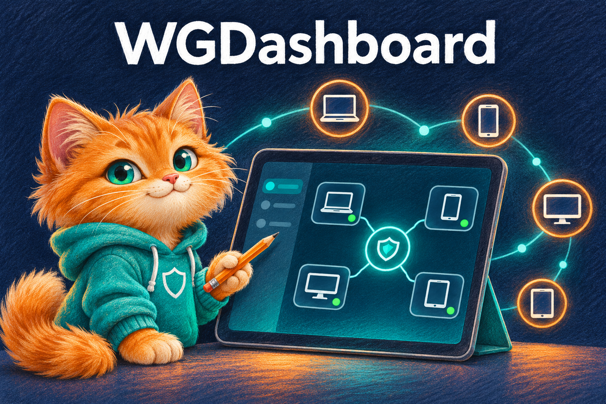
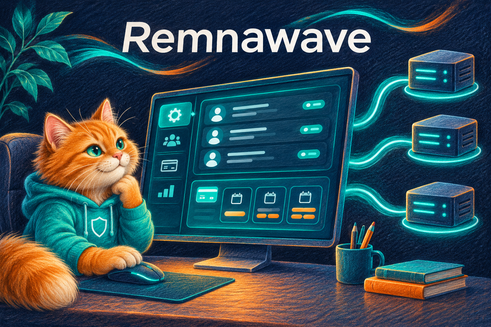
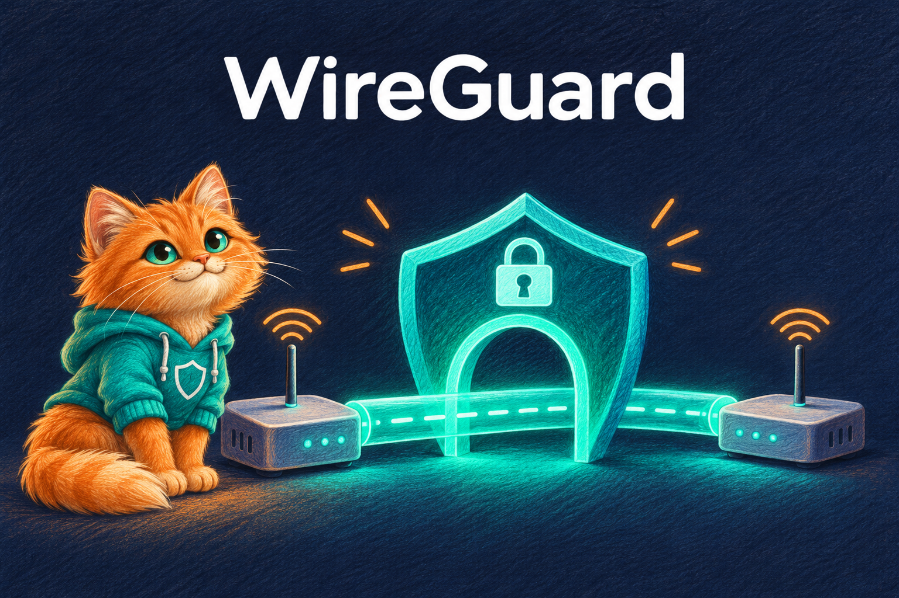
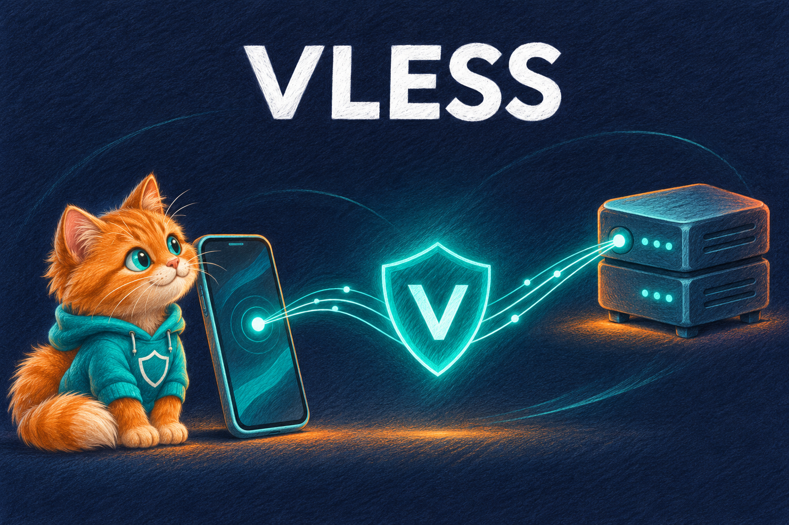

# Pushok VPN

**Ваш магазин VPN. Ваш бренд. Ваши правила.**

Сайт · Telegram-бот · Mini App · Управление подключениями через API

[Установка](docs/INSTALL_QUICKSTART.md) · [Возможности](#возможности-shop) · [Технологии](#технологии-подключения) · [План развития](docs/ROADMAP.md)

Shop VPN — самостоятельный магазин подключений VLESS и WireGuard для владельцев своих серверов и доменов. Покупатель выбирает тариф, оплачивает заказ и получает настройки подключения; владелец управляет продажами, клиентами и панелями из своего кабинета.

У Shop собственные код, база, интерфейс и логика продаж. Панели подключаются через отдельные API-адаптеры; другой магазин для работы не требуется. Фирменный стиль Pushok — рыжий кот, бирюзовый, тёмно-синий и оранжевый, иллюстрации цветными карандашами.

> **Статус: подготовка к запуску.** Последний опубликованный релиз и закреплённый установщик — **v0.054**. В `main` есть более новые изменения. Реальные платежи, целевые панели и чистая установка на VPS требуют приёмки. [Отчёт о готовности](docs/LAUNCH_READINESS.md) содержит результаты проверки и открытые блокеры; актуальный CI показан выше.

## Возможности Shop

| Покупателю | Владельцу |
|---|---|
| Личный кабинет на сайте и в Telegram Mini App | Управление тарифами, сроками и лимитами устройств |
| Покупка, пробный доступ и продление подписки | Подключение серверов и проверка их API |
| Ссылка, QR-код, скачивание конфигурации и инструкции | Заказы, подтверждения оплаты и повтор выдачи при сбое |
| Профили устройств и перевыпуск ключей | Промокоды, реферальные бонусные дни и настройки магазина |
| История заказов, статусы выдачи и поддержка | Роли сотрудников, аудит, поддержка и аналитика |
| Stars в Telegram; СБП/ЮKassa для email-аккаунтов сайта | Настраиваемое меню бота, диагностика, резервные копии и обновление |

Это возможности текущего кода, а не подтверждение их проверки на вашем VPS. RUB и XTR учитываются раздельно. Общий денежный кошелёк, расширенные акции и автоматические возвраты остаются отдельными этапами.

## Технологии подключения

Самостоятельные проекты и протоколы, с которыми работает архитектура Shop. Нажмите на карточку, чтобы открыть официальный ресурс. Иллюстрации созданы для Pushok; они не являются официальными логотипами или свидетельством спонсорства.

### Панели управления

| 3x-ui | WGDashboard | Remnawave |
|:---:|:---:|:---:|
|  |  |  |
| Панель управления подключениями. Shop использует API для выдачи, продления и отключения VLESS-клиентов. | Веб-панель WireGuard. Shop использует API для работы с peers, конфигурациями и сроками доступа. | Панель управления пользователями и подписками. Shop подключается непосредственно по REST API. |
| [Официальный проект](https://github.com/MHSanaei/3x-ui) · [Настройка в Shop](docs/THREEXUI_API.md) | [Документация](https://docs.wgdashboard.dev/) · [Настройка в Shop](docs/WGDASHBOARD.md) | [Официальный проект](https://github.com/remnawave/panel) · [Настройка в Shop](docs/REMNAWAVE.md) |

### Протоколы подключения

| WireGuard | VLESS |
|:---:|:---:|
|  |  |
| VPN-протокол с ключами и конфигурациями клиентов. Shop выдаёт доступ через свой агент или API WGDashboard. | Протокол соединения клиента с сервером. Shop управляет доступом через API панели; транспорт и его защита настраиваются на сервере. |
| [Официальный сайт](https://www.wireguard.com/) · [Проверка подключения](docs/WIREGUARD_STAGING.md) | [Официальная документация](https://xtls.github.io/en/config/inbounds/vless.html) · [API панелей](docs/PANEL_CHECK.md) |

[Подробнее о роли каждой технологии и границах совместимости →](docs/TECHNOLOGIES.md)

## Установка на ваш VPS

Целевая система — Ubuntu 24.04 LTS. Домен указывает владелец; магазин работает по пути `/shop`, например `https://example.com/shop`. Уже установленную панель можно подключить по API.

**Начните с [короткой инструкции](docs/INSTALL_QUICKSTART.md):** в ней показано, как подключиться к VPS, обновить систему, скачать установщик и что отвечать на каждый вопрос мастера.

| Ситуация | Инструкция |
|---|---|
| Первый запуск и ответы в диалоге | [Быстрый старт](docs/INSTALL_QUICKSTART.md) |
| Подробная установка и HTTPS | [Установщик](docs/INSTALL.md) |
| Дополнительно установить 3x-ui или WGDashboard | [Установка и настройка панелей](docs/PANELS_SETUP.md) |
| Настроить СБП и Stars | [Платежи](docs/SBP_PAYMENTS.md) |
| Проверить, что магазин действительно готов | [Стендовая приёмка](docs/STAGING.md) |

Новые подсказки и выбор установки панелей находятся в `main`; загрузчик пока получает архив v0.054. Новый установочный релиз выпускается после обязательных проверок.

## Документация и развитие

- [Техническое руководство](docs/TECHNICAL_GUIDE.md) — подробности функций, настройки и API.
- [План развития](docs/ROADMAP.md) · [Принципы продукта и выбранные улучшения](docs/PRODUCT_DESIGN.md).
- [Состояние заказа](docs/ORDER_STATUS.md) · [Меню Telegram](docs/TELEGRAM_MENU.md).
- [Резервное копирование](docs/BACKUP.md) · [Обновление и откат](docs/UPGRADE.md) · [Диагностика](docs/DIAGNOSTICS.md).
- [История изменений](CHANGELOG.md) · [Задачи](https://github.com/mrkoster1988/Shop-VPN-/issues) · [Релизы](https://github.com/mrkoster1988/Shop-VPN-/releases).

Ближайший приоритет — закрыть блокеры CI и восстановление, выпустить проверенный установщик и пройти полный цикл «оплата → выдача → VPN-трафик → продление → отключение».

---

**Pushok VPN** — собственный магазин с понятными настройками и проверяемыми результатами. Разработка ведётся в этом GitHub-репозитории.
