# Технологии подключения puShok shop VPN

puShok shop VPN — самостоятельный магазин со своей базой пользователей, тарифами, заказами и платежами. Панель управляет доступом на сервере; магазин обращается к ней через адаптер. Протокол и панель — разные уровни системы.

**Статус в магазине:** выдача VLESS, VMess, Hysteria2, TUIC и WireGuard реализована в коде и требует приёмки на целевых серверах. Остальные шесть карточек показывают действующие технологии, интеграция которых запланирована. VMess, Hysteria2 и TUIC появляются в продаже только при наличии настроенного активного сервера.

Официальные источники сверены **12 ноября 2026 года**. Доступность у конкретного оператора и совместимость конкретных версий проверяются отдельно.

В админке также есть [справочник протоколов](PROTOCOLS.md) с фильтрами статусов и требованиями к подключению. Он использует общий реестр с каталогом продаж, сохраняя различие между реализованными и планируемыми путями выдачи.

## Панели управления

  <a href="https://github.com/MHSanaei/3x-ui">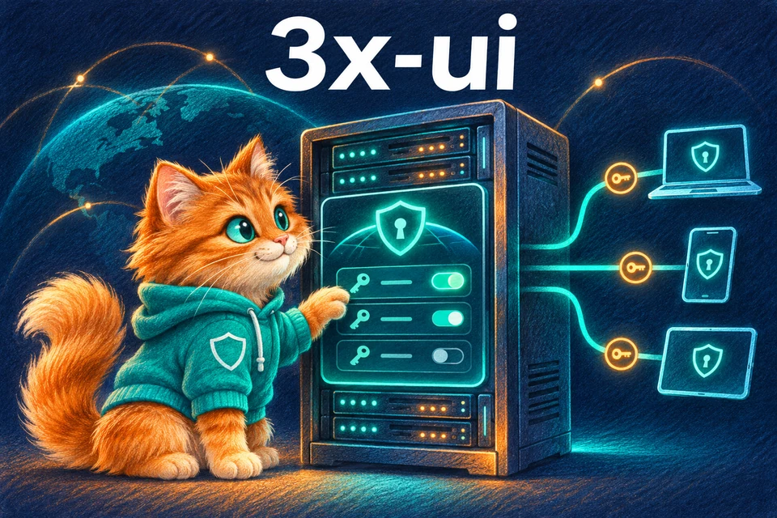</a>
  &nbsp; <a href="https://github.com/WGDashboard/WGDashboard">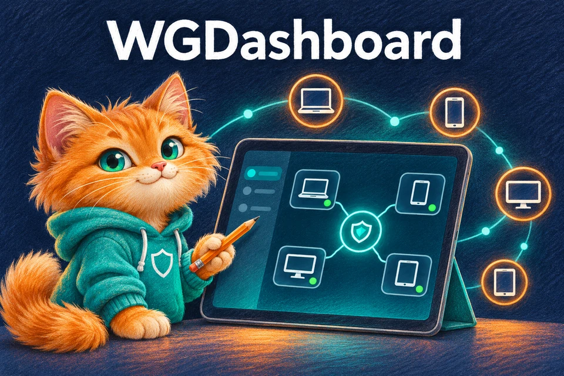</a>
  &nbsp; <a href="https://docs.rw/">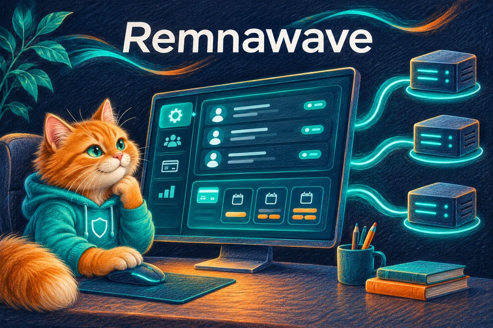</a>

### 3x-ui

Выдача, продление и отключение VLESS и VMess AEAD через API. [Настройка VMess](VMESS.md).

[Официальный ресурс](https://github.com/MHSanaei/3x-ui) · [Настройка в puShok shop VPN](THREEXUI_API.md)

### WGDashboard

Управление WireGuard peers и выдача конфигураций через API.

[Официальный ресурс](https://github.com/WGDashboard/WGDashboard) · [Настройка в puShok shop VPN](WGDASHBOARD.md)

### Remnawave

Пользователи, сроки и подписки через прямой REST API.

[Официальный ресурс](https://docs.rw/) · [Настройка в puShok shop VPN](REMNAWAVE.md)

### S-UI

API-панель для реализованных путей Hysteria2 и TUIC. Магазин использует отдельный адаптер apiv2.

[Официальный проект](https://github.com/alireza0/s-ui) · [Настройка](HYSTERIA2.md)

## Протоколы

### VLESS

  <a href="https://xtls.github.io/en/config/inbounds/vless.html">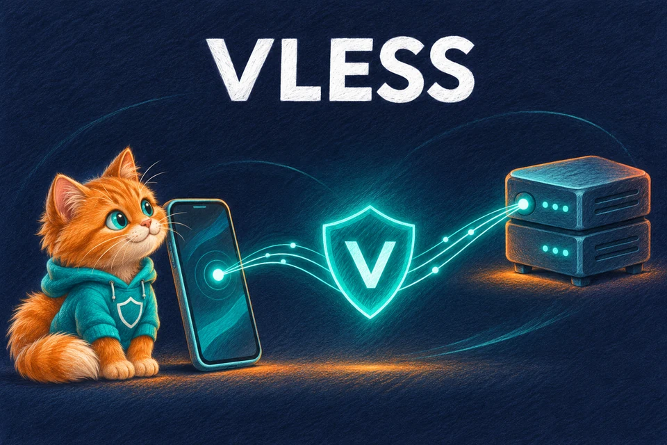</a>

**В коде магазина · требуется стендовая приёмка.**

Лёгкий протокол с UUID. Защита и транспорт выбираются в конфигурации сервера: например, TLS или REALITY.

В магазине есть выдача VLESS через API 3x-ui и Remnawave. Параметры ссылки должны совпадать с inbound панели. В новых Xray также существует VLESS Encryption; поддержку конкретной конфигурации нужно проверять у клиента.

[Официальная документация / проект](https://xtls.github.io/en/config/inbounds/vless.html)

### WireGuard

  <a href="https://www.wireguard.com/">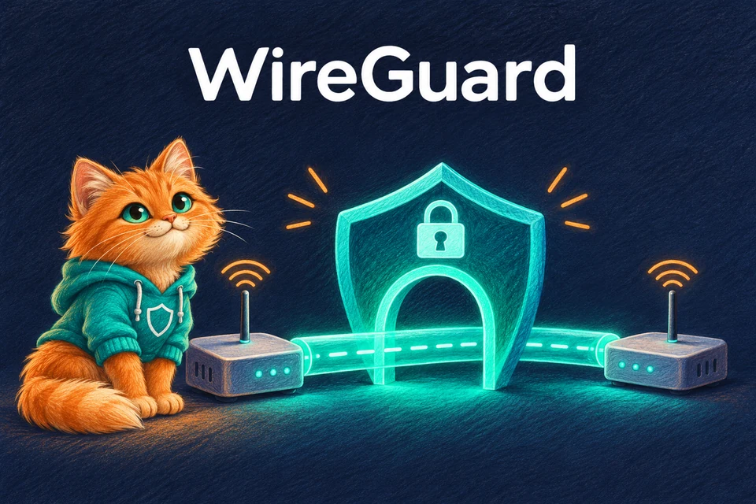</a>

**В коде магазина · требуется стендовая приёмка.**

VPN-туннель с ключами устройств. Конфигурация и QR-код для подключения.

В магазине есть путь через собственный WireGuard-агент и через API WGDashboard. Проверка API дополняется проверкой реального туннеля, продления и отзыва доступа.

[Официальная документация / проект](https://www.wireguard.com/)

### VMess

  <a href="https://www.v2fly.org/en_US/developer/protocols/vmess.html">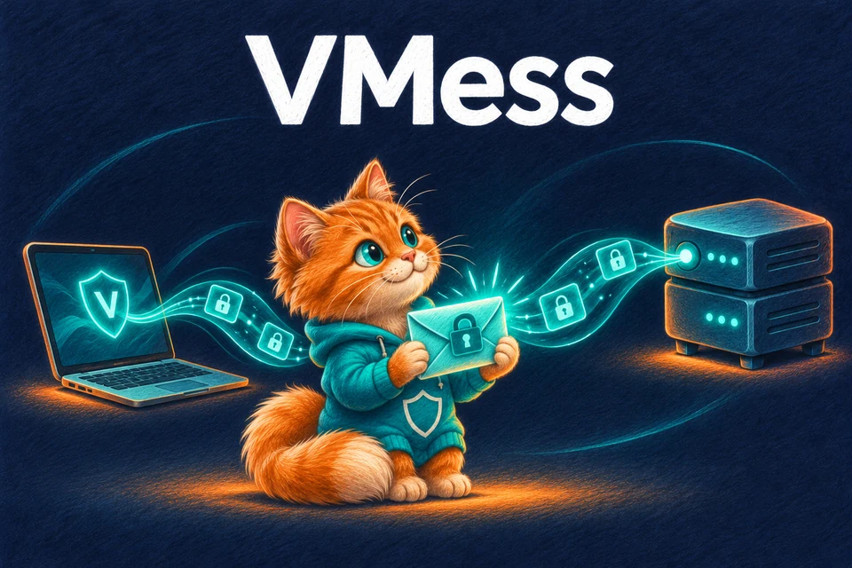</a>

**В коде магазина · требуется стендовая приёмка.**

Шифрованный прокси-протокол с UUID. Для новых конфигураций — аутентификация AEAD.

Поддерживается Xray и sing-box. Старый режим аутентификации MD5 устарел; для нового доступа нужен AEAD. Время клиента и сервера должно быть синхронизировано. В магазине реализован путь через 3x-ui Clients JSON: TCP/WS + TLS, выдача `vmess://`, продление и отзыв. Legacy API, другие транспорты и обновляемый URL подписки VMess пока не поддерживаются. [Настройка и приёмка](VMESS.md).

[Официальная документация / проект](https://www.v2fly.org/en_US/developer/protocols/vmess.html)

### Trojan

  <a href="https://sing-box.sagernet.org/manual/proxy-protocol/trojan/">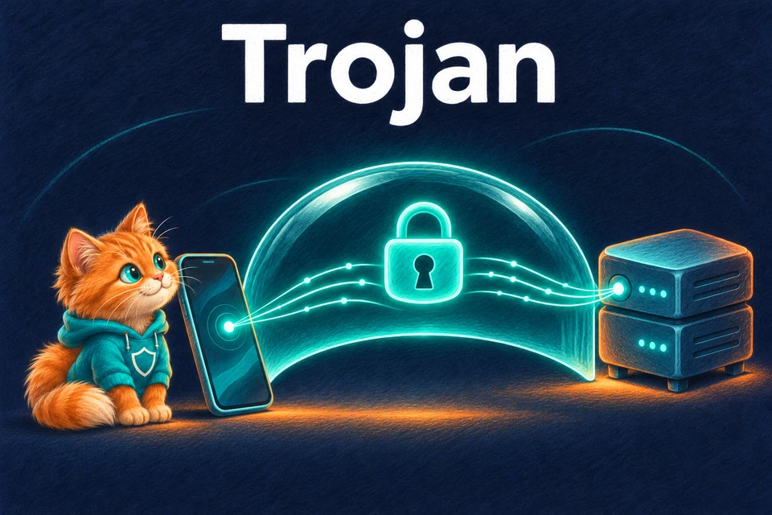</a>

**Интеграция запланирована · выдачи в магазине пока нет.**

Прокси-соединение с защитой TLS и аутентификацией по паролю.

Нужны согласованные настройки TLS, серверного имени и аутентификации. Для магазина предстоит реализовать управление учётными данными, выдачу конфигурации и отзыв доступа.

[Официальная документация / проект](https://sing-box.sagernet.org/manual/proxy-protocol/trojan/)

### Shadowsocks / Shadowsocks 2022

  <a href="https://sing-box.sagernet.org/manual/proxy-protocol/shadowsocks/">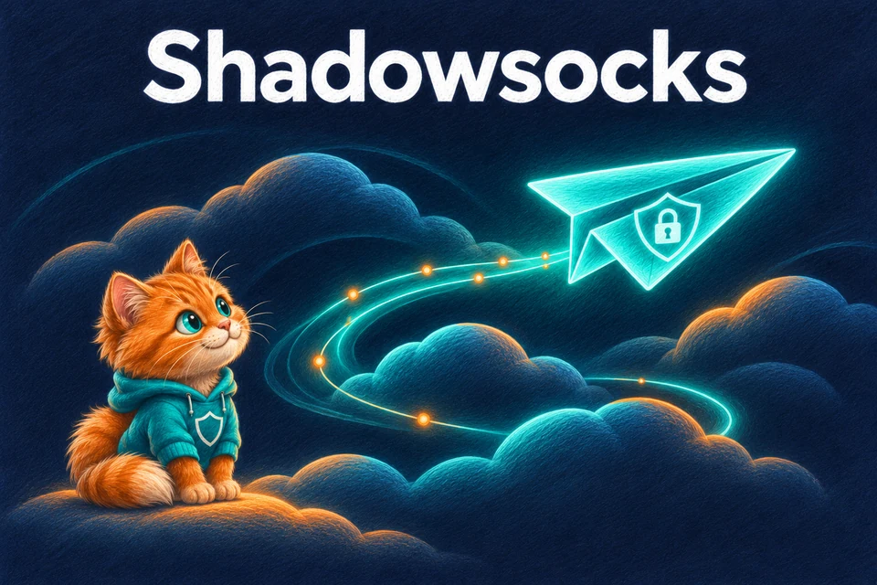</a>

**Интеграция запланирована · выдачи в магазине пока нет.**

Семейство шифрованных прокси. Метод шифрования и формат ключа должны поддерживаться клиентом.

Shadowsocks 2022 учитывается отдельно при выборе метода и ключей. Совместимость с обычным Shadowsocks нельзя предполагать автоматически. Интеграция должна учитывать возможности выбранного сервера и клиентских приложений.

[Официальная документация / проект](https://sing-box.sagernet.org/manual/proxy-protocol/shadowsocks/)

### AnyTLS

  <a href="https://sing-box.sagernet.org/configuration/inbound/anytls/">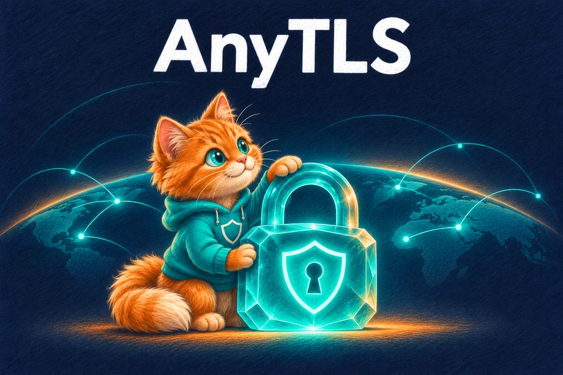</a>

**Интеграция запланирована · выдачи в магазине пока нет.**

Прокси поверх TLS с настраиваемым дополнением пакетов. Требуется совместимое приложение.

Есть реализация в sing-box. Перед добавлением продаж нужно проверить выбранную панель или серверный API, клиентские версии, выдачу конфигураций и отключение пользователя.

[Официальная документация / проект](https://sing-box.sagernet.org/configuration/inbound/anytls/)

### Hysteria2

  <a href="https://v2.hysteria.network/">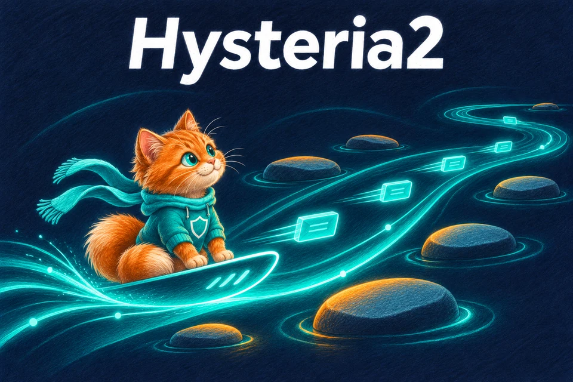</a>

**В коде магазина · требуется стендовая приёмка.**

Прокси на базе QUIC, разработанный для соединений с потерями и нестабильным качеством сети.

Реализован отдельный адаптер S-UI apiv2: выдача, продление, отключение и закрытие сессий, с TLS и необязательным Salamander. [Настройка и приёмка](HYSTERIA2.md). Доступность UDP/QUIC и фактическую скорость нужно проверять в целевых сетях.

[Официальная документация / проект](https://v2.hysteria.network/)

### TUIC

  <a href="https://github.com/tuic-protocol/tuic">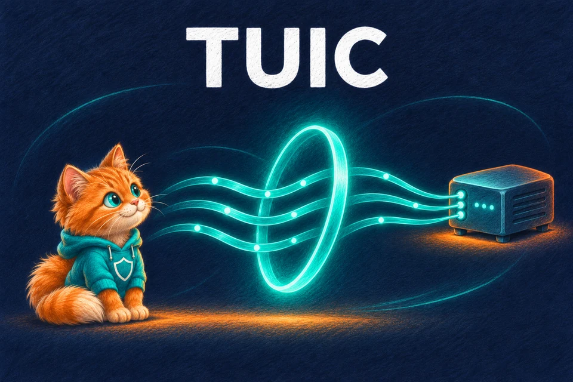</a>

**В коде магазина · требуется стендовая приёмка.**

Прокси на базе QUIC с передачей TCP/UDP и несколькими потоками в одном соединении.

В магазине реализован TUIC v5 через S-UI: UUID + пароль, TLS с ALPN h3, выдача и проверяемый отзыв сессий. Выбранные режим UDP и алгоритм передаются в ссылке. [Настройка и приёмка](TUIC.md).

[Официальная документация / проект](https://github.com/tuic-protocol/tuic)

### AmneziaWG

  <a href="https://docs.amnezia.org/documentation/amnezia-wg/">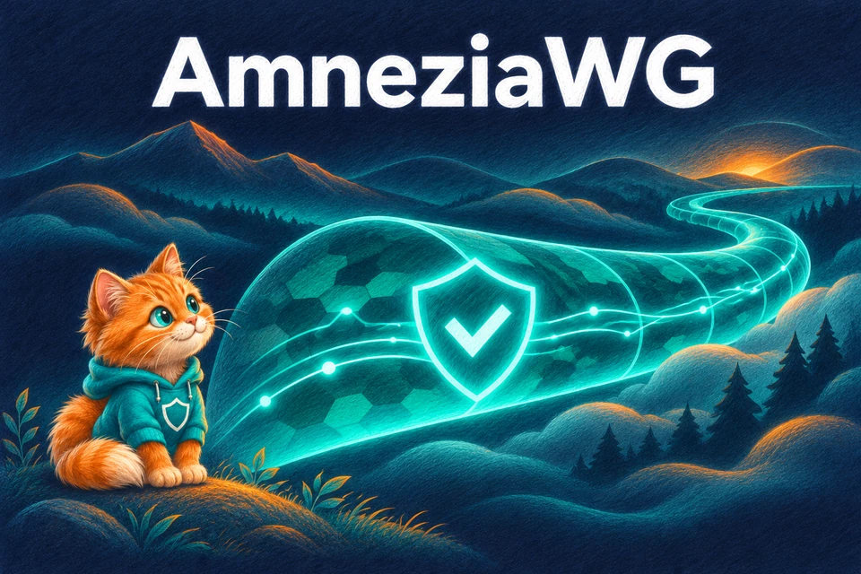</a>

**Интеграция запланирована · выдачи в магазине пока нет.**

Основа WireGuard с дополнительной маскировкой признаков трафика.

Для механизмов маскировки требуется совместимый клиент и согласованные параметры версии. Нельзя считать существующий адаптер WireGuard готовым адаптером AmneziaWG без отдельной реализации и проверки.

[Официальная документация / проект](https://docs.amnezia.org/documentation/amnezia-wg/)

### OpenVPN

  <a href="https://openvpn.net/community/">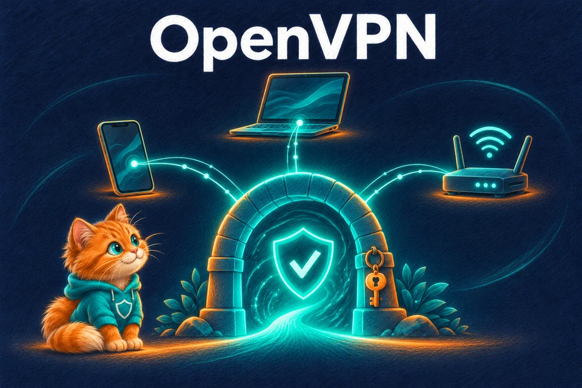</a>

**Интеграция запланирована · выдачи в магазине пока нет.**

VPN для пользовательских устройств, удалённого доступа и соединения сетей.

Для интеграции нужно выбрать управляющий сервер или API, реализовать выдачу профилей, управление сертификатами/учётными данными и отзыв доступа. Наличие OpenVPN в системе само по себе не подключает его к магазину.

[Официальная документация / проект](https://openvpn.net/community/)

### IKEv2 / IPsec

  <a href="https://docs.strongswan.org/docs/latest/howtos/introduction.html">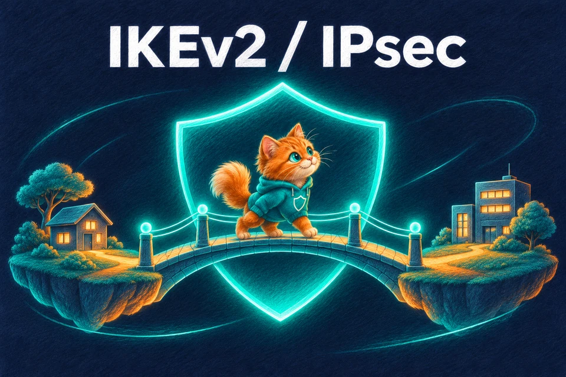</a>

**Интеграция запланирована · выдачи в магазине пока нет.**

Защищённый доступ к сети: IKEv2 согласует параметры, IPsec защищает трафик.

Одна из серверных реализаций — strongSwan. Для магазина нужны управление пользователями или сертификатами, выдача профилей, учёт срока и отключение. Способ настройки зависит от клиентской платформы.

[Официальная документация / проект](https://docs.strongswan.org/docs/latest/howtos/introduction.html)

## Защита и транспорт

TLS и REALITY относятся к защите транспорта. WebSocket, gRPC и XHTTP — транспортные варианты. Их поддержка зависит от ядра, панели, клиента и выбранной конфигурации; это не отдельные панели управления. [Документация Xray](https://xtls.github.io/en/config/transport.html).

## Условия готовности новой интеграции

1. Определены поддерживаемые версии панели, серверного ядра и клиентских приложений.
2. Проверены создание пользователя, повтор запроса после сбоя и сохранение идентичности при продлении.
3. Клиент получает рабочую конфигурацию, а реальный трафик проходит через целевой сервер.
4. Истечение срока и отзыв доступа действительно прекращают подключение; лимиты соответствуют тарифу.
5. Проверены ошибки API, восстановление и отсутствие повторной выдачи после повторного события оплаты.

Наличие протокола в документации ядра или панели не означает готовность его адаптера в магазине. Исходные пути VLESS/WireGuard сохраняются; неподдерживаемые протоколы не должны незаметно попадать в другой путь выдачи.

## Об иллюстрациях

Это оригинальная серия puShok с рыжим котом в бирюзовом худи, выполненная в стиле цветного карандаша. Изображения не являются официальными логотипами или схемами протоколов. Партнёрство и спонсорство не заявляются. [Описание файлов и запросы генерации](assets/technologies/README.md).
